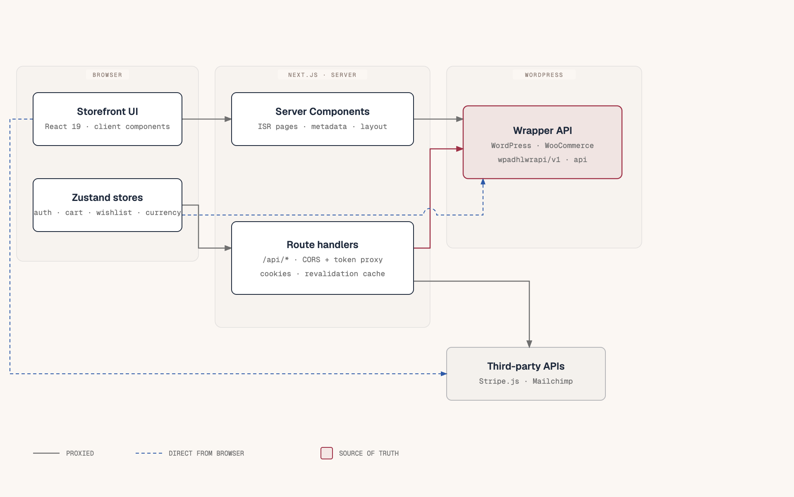

# Architecture

Diagram source: [diagrams/storefront-architecture.html](diagrams/storefront-architecture.html).

## Shape of the system

The storefront is a Next.js 16 App Router application. It renders every page itself and treats WordPress as a data source over HTTP. There is no WordPress theme in the request path, and no page is server-rendered by PHP.

Three tiers:

1. **Browser.** React 19 client components plus five Zustand stores. The browser holds the access token in memory, the guest cart token and guest wishlist IDs in `localStorage`, and the order result for the confirmation page in `sessionStorage`.
2. **Next.js server.** Server Components fetch catalog data during render. Route handlers under `src/app/api/` proxy endpoints that need CORS handling, cookie handling, or response normalization. ISR caches pages and some API reads.
3. **WordPress.** The wrapper plugin exposes WooCommerce data under `/wp-json`. It owns products, carts, orders, users, reviews, and tracking. It is the source of truth.

Third parties are narrow: Stripe.js tokenizes cards in the browser, and Mailchimp receives newsletter signups through a Next.js route. WordPress performs the actual charge through its Stripe integration.

## How a request travels

| Action | Path | Why |
| --- | --- | --- |
| Home, shop, product page load | Browser → Next.js RSC → WordPress `wpadhlwrapi/v1` | Server-side read, ISR cached |
| Public cart operations | Browser → WordPress `wpadhlwrapi/v1/cart/*` | `apiClient` calls the wrapper directly; the guest token travels in the Authorization header |
| Login, register, refresh, logout | Browser → `/api/auth/*` → WordPress `api/auth/*` | Keeps refresh tokens in httpOnly cookies; avoids exposing them to JavaScript |
| Checkout and profile | Browser → `/api/checkout`, `/api/auth/me` → WordPress `api/*` | Avoids CORS preflight failures on authenticated POSTs |
| Orders | Browser → `/api/account/orders` → WordPress `api/orders` | Proxy also removes `checkout-draft` rows and repairs pagination |
| Wishlist | Browser → `/api/wishlist/*` → WordPress `api/wishlist` | Authenticated, CORS-sensitive |
| Reviews (read) | Browser → `/api/reviews/*` → WordPress `wpadhlwrapi/v1/reviews/*` | CORS-safe read; the server-rendered product page calls the aggregate directly |
| Reviews (write, media, delete) | Browser → `/api/reviews/*` → WordPress `api/reviews/*` | Bearer token and multipart uploads |
| Tracking (guest) | Browser → `/api/tracking/search` → WordPress `api/tracking/search` | Public POST with email |
| Tracking (signed in) | Browser → `/api/tracking/order/:id` → WordPress `api/tracking/order/:id` | Bearer token required |
| Newsletter | Browser → `/api/newsletter` → Mailchimp | Secret key stays on the server |
| Store settings / currency | Browser → `/api/store-settings` → WordPress `wpadhlwrapi/v1/store-settings` | One-hour cache, no CORS |

The diagram marks the public cart path as a direct browser call and the authenticated paths as proxied. That distinction matters when debugging: a CORS error means the call should have gone through `/api`.

## Rendering strategy

Catalog routes (`/`, `/products`, and product detail) are Server Components with 60-second ISR. Cart, checkout, account, tracking, and order confirmation are client pages because they depend on store state or browser storage. Login, registration, and password routes are static shells around client forms.

The route-by-route map, including auth requirements, is in [routing-and-pages.md](routing-and-pages.md).

Server Components never receive the access token from `cookies()` in the current code. Authenticated pages are client pages. This is a deliberate simplification; see [ADR-0003](adr/0003-cookie-backed-auth.md) and [known-gaps.md](known-gaps.md).

## Caching

| Data | Where | Revalidation |
| --- | --- | --- |
| Product list and detail | `getProducts`, `getProduct` | 60 s |
| Product filters | `getProductFilters` | 6 h |
| Menus | `getMenuByLocation` | 5 min |
| Store settings | `/api/store-settings` | 1 h, plus `Cache-Control` for the CDN |
| Review aggregate | `getRatingAggregate` | 5 min on the server; no-store in the browser |
| Random reviews | `getRandomReviews` | 10 min on the server; no-store in the browser |
| Review list | `getProductReviews` | No cache |
| Orders, tracking, wishlist, auth | Route handlers | No cache |

`revalidate = 60` on a page is the page-level hint; the `fetch` calls inside also set their own revalidation. Both values exist, so changing only the page export may not change how an individual API response is cached.

## Error model

The API layer throws `ApiError` with a string `code` and a human message. `client.ts` parses `{ success: false, code, message }` responses and also converts non-JSON failures into `ApiError('http_error', 'HTTP <status>')`.

Consumers handle errors in three places:

- **Server pages** catch and degrade: an empty product grid, empty filters, or `notFound()` for a missing product.
- **Stores** put the message in `error` and, for cart and wishlist, roll back optimistic state.
- **Forms** map known codes to copy. `CheckoutForm` has `API_ERRORS`; `ReviewForm` has `friendlyError()`.

A 401 in the browser triggers one refresh attempt. If the retry is also 401, `authStore` clears the session and redirects only when a real access token existed. A guest cart token must not force a login redirect; that rule is the fix for a previous redirect loop.

## Boundaries that carry weight

**WordPress is authoritative.** The front end normalizes shapes but does not compute prices, stock, or order state. If a value is wrong, check WordPress before adding client logic.

**Proxies are not a security layer.** They forward the caller's bearer token. They exist for CORS, cookies, caching, and small response fixes. Authorization is enforced by WordPress.

**Client stores are the only shared client state.** There is no React Context for commerce data and no server-state library. A new cross-component value belongs in a store or in the API layer, not in a context provider added for one screen.

**The browser can hold three kinds of identity.** A user access token (memory), a guest cart token (localStorage), and a refresh token (httpOnly cookie). Any change to auth must account for all three and for the merged-cart path.

## Related

- [ADR-0001: Next.js App Router as the storefront](adr/0001-nextjs-app-router.md)
- [ADR-0002: Zustand stores and hydrators](adr/0002-zustand-and-hydrators.md)
- [ADR-0003: Cookie-backed authentication](adr/0003-cookie-backed-auth.md)
- [ADR-0004: Next.js route handlers as proxies](adr/0004-proxy-route-handlers.md)
- [flows/authentication.md](flows/authentication.md)
- [data-layer.md](data-layer.md)
