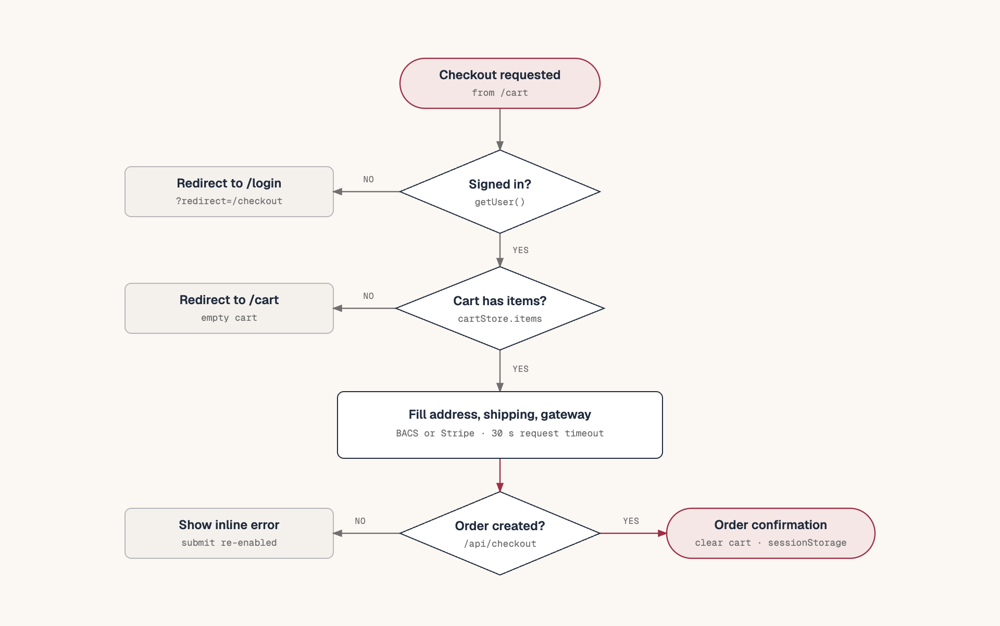

# Cart and checkout flow

## Add to cart

```
ProductCard / VariationSelector
  → cartStore.addItem(productId, variationId, quantity, attributes)
  → optimistic temp CartItem appended
  → apiAddToCart()
  → POST /wp-json/wpadhlwrapi/v1/cart/add
  → server returns the full cart
  → if this is the first guest add: save data.guest_token to localStorage['cart_token']
  → replace items with the server list
  → on failure: remove the temp item, set error
```

`ProductCard` adds simple products directly with `variationId = 0`. Variable products link to the detail page, where the user chooses attributes and `VariationSelector` adds the selected variation ID and attribute map.

The optimistic temp item has `id: temp-<timestamp>` and the name "Adding…". It exists only until the server responds.

The API serializes attributes into `meta` as `{ "attributes": { "pa_color": "Red" } }`.

## Drawer and cart page

The header cart button opens `CartDrawer`. The drawer reads the same store as the page. Both show the same items; the markup differs.

`CartHydrator` fetches the cart on layout mount. `CartPageContent` only retries when the store has no items, no `lastFetchedAt`, and no request in flight, so opening `/cart` does not duplicate the GET.

Coupons, free shipping, and cart expiry are not implemented. Their UI was removed rather than left behind a flag that does nothing. Any of them needs a server contract first: coupon validation and discount lines, a server-owned free-shipping threshold, or a server-owned cart TTL.

`CartSummary` reads `cartStore.shippingMethods`, which come from the cart API or the shared `DEFAULT_SHIPPING_METHODS` in `src/lib/api/cart.ts`. It lists methods with their prices and tells the customer that checkout owns the selection. Checkout uses the same store, so the two surfaces cannot disagree.

## Checkout initialization



Diagram source: [checkout-flow.html](../diagrams/checkout-flow.html).

```
/checkout page
  → getUser()
      success → profile for prefill
      session_expired / invalid_token → /login?redirect=/checkout
      other error → continue without prefill
  → if cartStore.items is empty → /cart
  → render CheckoutForm
```

The cart must already be hydrated. If the visitor lands on `/checkout` directly with a saved cart, `CartHydrator` fetches it after auth hydration; if that has not completed, the page sees an empty cart and redirects. In practice, navigating from the cart page avoids this race.

## Form

`CheckoutForm` uses react-hook-form with a zod schema.

Required billing fields: first name, email, phone, address, country, state, city, postcode.

Shipping fields are required only when "same as billing" is off. When it is on, watchers copy billing values into shipping on every change.

Shipping method is required. The first method from the store becomes the default when methods load.

Terms acceptance is required.

The gateway defaults to BACS. Stripe shows `StripeForm`; BACS shows `BacsInfo`.

Countries and states come from `getCountries()`. If that call fails, the country list is empty and the selects have no options. The form still renders.

## Submit

```
onSubmit
  → re-fetch cart
  → if empty → /cart
  → if Stripe: stripeRef.getPaymentMethodId()
      null → show card error, stop
  → placeOrder({ gateway, payment_data, billing, shipping, method, cost })
      browser → POST /api/checkout → WordPress POST /wp-json/api/checkout
  → race against a 30 s timeout
  → success:
      clearCart()
      sessionStorage['order_<id>'] = result
      /order-confirmation/<id>
  → failure:
      ApiError → mapped message or raw message
      timeout → "Request timed out"
      other → generic message
```

`placeOrder` sends shipping only when it differs from billing. It always sends the selected shipping method and cost. WordPress owns the final total.

Error mapping:

| Code | Message |
| --- | --- |
| `invalid_token`, `session_expired` | Session expired, log in again |
| `empty_cart` | Cart is empty |
| `unknown_gateway` | Unknown payment method |
| `out_of_stock` | One or more items are out of stock |
| `order_creation_failed` | Failed to create the order |
| `payment_failed` | Card declined |

Validation failures do not reach the API. `onError` builds a "Missing: …" sentence from a label map, so the user sees which fields are empty instead of a silent no-op.

## Totals

The displayed totals are computed in the browser:

- subtotal = sum of `price × quantity` over cart items,
- shipping = selected method cost,
- total = subtotal + shipping.

No tax, discount, or coupon is applied. The cart API returns line prices and the checkout API creates the order with WooCommerce totals. The confirmation page does not show the total; it shows status and payment reference only.

## Gateways

**BACS.** The order is created as `pending` without a transaction ID. The confirmation page detects `status === 'pending' && !transaction_id` and shows bank-transfer instructions. Banking details are also emailed by WordPress.

**Stripe.** `StripeForm` loads Stripe.js with `NEXT_PUBLIC_STRIPE_PK`, renders a `CardElement`, and creates a PaymentMethod. The form sends only `payment_method_id`. WordPress performs the charge. A declined card surfaces as `payment_failed`.

If the Stripe key is missing, the card element cannot initialize. If the dynamic import has not resolved, the form waits 200 ms and then shows "Payment form not ready".

## Confirmation

`/order-confirmation/[id]` reads `sessionStorage['order_<id>']`, keeps it for refreshes, clears the cart again as a safety measure, and shows:

- completed icon and "Payment Completed" when `status === 'completed'`,
- pending icon and "Pending Payment" otherwise,
- transaction ID when present,
- BACS instructions for a pending order with no transaction.

A direct visit or a cleared session falls back to `getOrders(1, 100)` for a signed-in user and finds the order by ID. If neither the stored result nor a recent order matches, the page shows a "could not load" message with a link to the account orders instead of an empty heading.

## Failure states to preserve

- Out-of-stock add: optimistic item disappears, inline error under the product action.
- Invalid or expired session at checkout: redirect to login with a return path.
- Empty cart after re-fetch: redirect to cart.
- Stripe tokenization failure: inline card error, no order created.
- API failure: banner above the form, submit re-enabled.
- Timeout: specific timeout message, not a generic failure.
- Validation failure: named missing fields.

## Related

- [../state-management.md](../state-management.md)
- [../data-layer.md](../data-layer.md)
- [authentication.md](authentication.md)
- [../routing-and-pages.md](../routing-and-pages.md)
